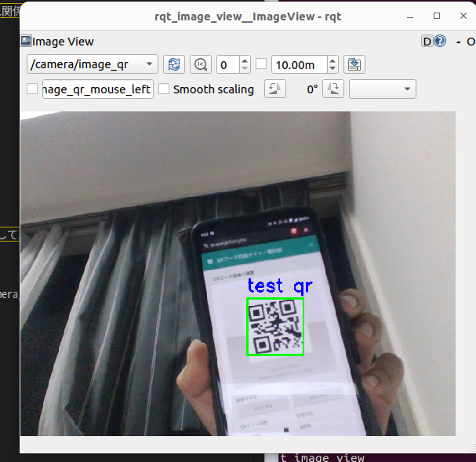

# qr_code_detector  
imageをサブスクライブして、QRコード上に内容(デコードした文字列)を描画したimageをパブリッシュするnode  
ros2処女作かつ、gpt君と戯れながら作ったので色々怪しいので、ツッコミが沢山ほしいやつです  

## 依存  
基本的に(おそらくros1と同じく)zbarってライブラリを使ってるので、それ関係が入っていればだ丈夫なはずです  
```
sudo apt install libzbar0
pip3 install pyzbar

pip3 install opencv-python
```  
一応、動作確認した環境はこれです  
```
pyzbar        0.1.9
opencv-python 4.10.0.84
```  

## つかいかた  
入出力は`/camera/image_raw`をサブスクライブして`/camera/image_qr`としてパブリッシュする  

適当なUSBカメラを用意してv4l2-cameraを起動  
```
ros2 run v4l2_camera v4l2_camera_node --ros-args -r /image_raw:=/camera/image_raw
```

rq_detectorを起動
```
ros2 run qr_code_detector qr_code_detector_node
```

確認用にrqt_image_viewを起動  
```
ros2 run rqt_image_view rqt_image_view
```

一応これでこんな感じに動いてくれる  
  

## 課題  
- 認識が結構厳しめ、もう少し曖昧でも認識されたし  
- 日本語は非対応(需要によっては開発したい)  
- 文字列以外も非対応(文字列以外のパターンをあまり知らないのでおそらくﾓｰﾏﾝﾀｲ)  
- 複数QRが表示されたときの挙動がまだよくわかっていない()  
